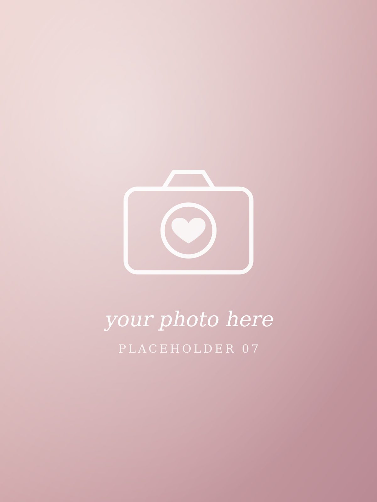

<!--
  ✍️  WRITING PROMPTS
  - Tiny habits of hers you love. The way she texts. Her favourite snacks.
  - Little rituals you two have built.
-->

Nobody tells you that love is mostly made of little things. Placeholder text, again, but here is where the small, precious details go: the way you text "hmm" when you're thinking, the songs you send me, how you always know exactly what I'm about to say.

There is the good-morning message that arrives before I've properly opened my eyes. There is the goodnight that somehow takes forty-five minutes. There is the way you read with your whole face, frowning at the villains and smiling at the parts you love.

I could fill a whole volume with just the little things. Maybe one day I will.
